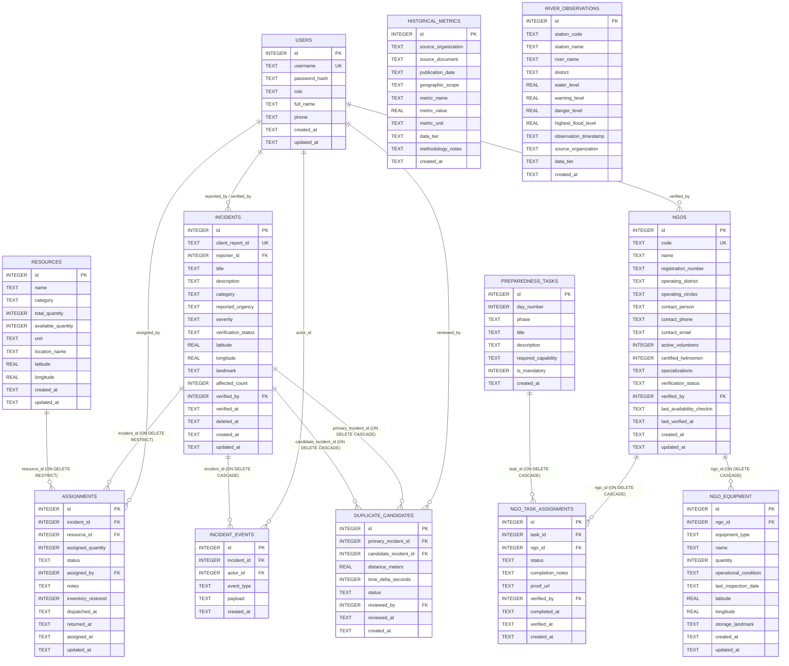

# Database Schema & Data Integrity — SURAKSHA GRID
### Relational SQLite Architecture (Engine: `better-sqlite3`)

---

## 1. Relational Entity-Relationship Diagram



---

## 2. Connection Initialization Pragmas

Every database connection established via `better-sqlite3` MUST execute these initialization pragmas immediately:

```sql
PRAGMA journal_mode = WAL;          -- Write-Ahead Logging for high-concurrency non-blocking reads
PRAGMA foreign_keys = ON;           -- Enforce relational integrity and constraint checks
PRAGMA busy_timeout = 5000;         -- Wait up to 5000ms for locks instead of throwing SQLITE_BUSY
PRAGMA synchronous = NORMAL;        -- Optimal durability-performance balance in WAL mode
```

---

## 3. Implemented Core Tables (Migration 001)

These 6 tables represent the core response coordination database established in Phase 3.1:

### Table 1: `users`
```sql
CREATE TABLE users (
    id INTEGER PRIMARY KEY AUTOINCREMENT,
    username TEXT NOT NULL UNIQUE COLLATE NOCASE,
    password_hash TEXT NOT NULL,
    role TEXT NOT NULL CHECK (role IN ('citizen', 'volunteer', 'coordinator', 'admin')),
    full_name TEXT NOT NULL,
    phone TEXT,
    created_at TEXT NOT NULL DEFAULT (strftime('%Y-%m-%dT%H:%M:%fZ', 'now')),
    updated_at TEXT NOT NULL DEFAULT (strftime('%Y-%m-%dT%H:%M:%fZ', 'now'))
);
CREATE INDEX idx_users_role ON users(role);
CREATE INDEX idx_users_username ON users(username);
```

### Table 2: `incidents`
```sql
CREATE TABLE incidents (
    id INTEGER PRIMARY KEY AUTOINCREMENT,
    client_report_id TEXT NOT NULL UNIQUE,  -- UUIDv4 generated client-side for idempotency
    reporter_id INTEGER REFERENCES users(id) ON DELETE SET NULL,
    title TEXT NOT NULL,
    description TEXT NOT NULL,
    category TEXT NOT NULL CHECK (category IN (
        'MAROONED_RESCUE', 'MEDICAL_EMERGENCY', 'FOOD_WATER_CRISIS', 'INFRASTRUCTURE_BREACH', 'GENERAL_RELIEF'
    )),
    reported_urgency TEXT CHECK (reported_urgency IN ('LOW', 'MEDIUM', 'HIGH', 'CRITICAL')),
    severity TEXT NOT NULL DEFAULT 'MEDIUM' CHECK (severity IN ('LOW', 'MEDIUM', 'HIGH', 'CRITICAL')),
    verification_status TEXT NOT NULL DEFAULT 'PENDING' CHECK (verification_status IN ('PENDING', 'VERIFIED', 'REJECTED', 'RESOLVED')),
    latitude REAL,
    longitude REAL,
    landmark TEXT NOT NULL,
    affected_count INTEGER NOT NULL DEFAULT 1 CHECK (affected_count >= 0),
    verified_by INTEGER REFERENCES users(id) ON DELETE SET NULL,
    verified_at TEXT,
    deleted_at TEXT,
    created_at TEXT NOT NULL DEFAULT (strftime('%Y-%m-%dT%H:%M:%fZ', 'now')),
    updated_at TEXT NOT NULL DEFAULT (strftime('%Y-%m-%dT%H:%M:%fZ', 'now'))
);
CREATE INDEX idx_incidents_client_id ON incidents(client_report_id);
CREATE INDEX idx_incidents_verification ON incidents(verification_status);
CREATE INDEX idx_incidents_severity ON incidents(severity);
CREATE INDEX idx_incidents_category ON incidents(category);
CREATE INDEX idx_incidents_coords ON incidents(latitude, longitude);
CREATE INDEX idx_incidents_created ON incidents(created_at DESC);
CREATE INDEX idx_incidents_active ON incidents(deleted_at) WHERE deleted_at IS NULL;
```

### Table 3: `resources`
```sql
CREATE TABLE resources (
    id INTEGER PRIMARY KEY AUTOINCREMENT,
    name TEXT NOT NULL,
    category TEXT NOT NULL CHECK (category IN (
        'WATER_PURIFICATION', 'FOOD_RATIONS', 'RESCUE_BOAT', 'MEDICAL_KIT', 'SHELTER_EQUIPMENT'
    )),
    total_quantity INTEGER NOT NULL CHECK (total_quantity >= 0),
    available_quantity INTEGER NOT NULL CHECK (available_quantity >= 0 AND available_quantity <= total_quantity),
    unit TEXT NOT NULL,
    location_name TEXT NOT NULL,
    latitude REAL,
    longitude REAL,
    created_at TEXT NOT NULL DEFAULT (strftime('%Y-%m-%dT%H:%M:%fZ', 'now')),
    updated_at TEXT NOT NULL DEFAULT (strftime('%Y-%m-%dT%H:%M:%fZ', 'now'))
);
CREATE INDEX idx_resources_category ON resources(category);
CREATE INDEX idx_resources_available ON resources(available_quantity);
```

### Table 4: `assignments`
```sql
CREATE TABLE assignments (
    id INTEGER PRIMARY KEY AUTOINCREMENT,
    incident_id INTEGER NOT NULL REFERENCES incidents(id) ON DELETE RESTRICT,
    resource_id INTEGER NOT NULL REFERENCES resources(id) ON DELETE RESTRICT,
    assigned_quantity INTEGER NOT NULL CHECK (assigned_quantity > 0),
    status TEXT NOT NULL DEFAULT 'ASSIGNED' CHECK (status IN (
        'ASSIGNED', 'IN_TRANSIT', 'DELIVERED', 'RETURNED', 'CANCELLED'
    )),
    inventory_restored INTEGER NOT NULL DEFAULT 0 CHECK (inventory_restored IN (0, 1)),
    assigned_by INTEGER NOT NULL REFERENCES users(id) ON DELETE RESTRICT,
    notes TEXT,
    dispatched_at TEXT,
    returned_at TEXT,
    assigned_at TEXT NOT NULL DEFAULT (strftime('%Y-%m-%dT%H:%M:%fZ', 'now')),
    updated_at TEXT NOT NULL DEFAULT (strftime('%Y-%m-%dT%H:%M:%fZ', 'now'))
);
CREATE INDEX idx_assignments_incident ON assignments(incident_id);
CREATE INDEX idx_assignments_resource ON assignments(resource_id);
CREATE INDEX idx_assignments_status ON assignments(status);
```

### Table 5: `incident_events`
```sql
CREATE TABLE incident_events (
    id INTEGER PRIMARY KEY AUTOINCREMENT,
    incident_id INTEGER NOT NULL REFERENCES incidents(id) ON DELETE CASCADE,
    actor_id INTEGER REFERENCES users(id) ON DELETE SET NULL,
    event_type TEXT NOT NULL CHECK (event_type IN (
        'CREATED', 'VERIFIED', 'REJECTED', 'SEVERITY_UPDATED',
        'RESOURCE_ASSIGNED', 'RESOURCE_DISPATCHED', 'RESOURCE_DELIVERED',
        'RESOURCE_RETURNED', 'ASSIGNMENT_CANCELLED', 'DUPLICATE_FLAGGED',
        'DUPLICATE_RESOLVED', 'STATUS_RESOLVED', 'INCIDENT_ARCHIVED'
    )),
    payload TEXT,
    created_at TEXT NOT NULL DEFAULT (strftime('%Y-%m-%dT%H:%M:%fZ', 'now'))
);
CREATE INDEX idx_events_incident ON incident_events(incident_id, created_at ASC);
CREATE INDEX idx_events_type ON incident_events(event_type);
```

### Table 6: `duplicate_candidates`
```sql
CREATE TABLE duplicate_candidates (
    id INTEGER PRIMARY KEY AUTOINCREMENT,
    primary_incident_id INTEGER NOT NULL REFERENCES incidents(id) ON DELETE CASCADE,
    candidate_incident_id INTEGER NOT NULL REFERENCES incidents(id) ON DELETE CASCADE,
    distance_meters REAL NOT NULL,
    time_delta_seconds INTEGER NOT NULL,
    status TEXT NOT NULL DEFAULT 'SUGGESTED' CHECK (status IN ('SUGGESTED', 'DISMISSED', 'MERGED')),
    reviewed_by INTEGER REFERENCES users(id) ON DELETE SET NULL,
    reviewed_at TEXT,
    created_at TEXT NOT NULL DEFAULT (strftime('%Y-%m-%dT%H:%M:%fZ', 'now')),
    CONSTRAINT uq_duplicate_pair UNIQUE (primary_incident_id, candidate_incident_id),
    CHECK (primary_incident_id < candidate_incident_id) -- Canonical ordering
);
CREATE INDEX idx_dup_primary ON duplicate_candidates(primary_incident_id);
CREATE INDEX idx_dup_candidate ON duplicate_candidates(candidate_incident_id);
CREATE INDEX idx_dup_status ON duplicate_candidates(status);
```

---

## 4. Proposed Migration 002 (NGO Network & Preparedness Architecture)

To be implemented in Phase 4.1 without altering existing working tables:

```sql
-- 1. ngos table
CREATE TABLE IF NOT EXISTS ngos (
    id INTEGER PRIMARY KEY AUTOINCREMENT,
    code TEXT NOT NULL UNIQUE,
    name TEXT NOT NULL,
    registration_number TEXT,
    operating_district TEXT NOT NULL DEFAULT 'Nagaon',
    operating_circles TEXT NOT NULL DEFAULT 'Kampur',
    contact_person TEXT NOT NULL,
    contact_phone TEXT NOT NULL,
    contact_email TEXT,
    active_volunteers INTEGER NOT NULL DEFAULT 0 CHECK (active_volunteers >= 0),
    certified_helmsmen INTEGER NOT NULL DEFAULT 0 CHECK (certified_helmsmen >= 0),
    specializations TEXT NOT NULL, -- Comma-separated or JSON array of standard specializations
    verification_status TEXT NOT NULL DEFAULT 'PENDING_VERIFICATION' CHECK (verification_status IN (
        'PENDING_VERIFICATION', 'VERIFIED_ACTIVE', 'INACTIVE_STALE', 'SUSPENDED'
    )),
    verified_by INTEGER REFERENCES users(id) ON DELETE SET NULL,
    last_availability_checkin TEXT,
    last_verified_at TEXT,
    created_at TEXT NOT NULL DEFAULT (strftime('%Y-%m-%dT%H:%M:%fZ', 'now')),
    updated_at TEXT NOT NULL DEFAULT (strftime('%Y-%m-%dT%H:%M:%fZ', 'now'))
);
CREATE INDEX IF NOT EXISTS idx_ngos_district ON ngos(operating_district);
CREATE INDEX IF NOT EXISTS idx_ngos_status ON ngos(verification_status);

-- 2. ngo_equipment table
CREATE TABLE IF NOT EXISTS ngo_equipment (
    id INTEGER PRIMARY KEY AUTOINCREMENT,
    ngo_id INTEGER NOT NULL REFERENCES ngos(id) ON DELETE CASCADE,
    equipment_type TEXT NOT NULL CHECK (equipment_type IN (
        'INFLATABLE_MOTORBOAT', 'COUNTRY_BOAT', 'WATER_PURIFIER_RO', 'TRAUMA_KIT', 'MOBILE_KITCHEN', 'HIGH_CAPACITY_PUMP', 'LIFEJACKET_SET'
    )),
    name TEXT NOT NULL,
    quantity INTEGER NOT NULL CHECK (quantity > 0),
    operational_condition TEXT NOT NULL DEFAULT 'OPERATIONAL' CHECK (operational_condition IN (
        'OPERATIONAL', 'STANDBY', 'REPAIR_REQUIRED'
    )),
    last_inspection_date TEXT NOT NULL,
    latitude REAL,
    longitude REAL,
    storage_landmark TEXT NOT NULL,
    created_at TEXT NOT NULL DEFAULT (strftime('%Y-%m-%dT%H:%M:%fZ', 'now')),
    updated_at TEXT NOT NULL DEFAULT (strftime('%Y-%m-%dT%H:%M:%fZ', 'now'))
);
CREATE INDEX IF NOT EXISTS idx_ngo_eqp_ngo ON ngo_equipment(ngo_id);
CREATE INDEX IF NOT EXISTS idx_ngo_eqp_type ON ngo_equipment(equipment_type);

-- 3. preparedness_tasks table
CREATE TABLE IF NOT EXISTS preparedness_tasks (
    id INTEGER PRIMARY KEY AUTOINCREMENT,
    day_number INTEGER NOT NULL CHECK (day_number BETWEEN 1 AND 7),
    phase TEXT NOT NULL,
    title TEXT NOT NULL,
    description TEXT NOT NULL,
    required_capability TEXT,
    is_mandatory INTEGER NOT NULL DEFAULT 1 CHECK (is_mandatory IN (0, 1)),
    created_at TEXT NOT NULL DEFAULT (strftime('%Y-%m-%dT%H:%M:%fZ', 'now'))
);
CREATE INDEX IF NOT EXISTS idx_prep_day ON preparedness_tasks(day_number);

-- 4. ngo_task_assignments table
CREATE TABLE IF NOT EXISTS ngo_task_assignments (
    id INTEGER PRIMARY KEY AUTOINCREMENT,
    task_id INTEGER NOT NULL REFERENCES preparedness_tasks(id) ON DELETE CASCADE,
    ngo_id INTEGER NOT NULL REFERENCES ngos(id) ON DELETE CASCADE,
    status TEXT NOT NULL DEFAULT 'ASSIGNED' CHECK (status IN (
        'ASSIGNED', 'IN_PROGRESS', 'COMPLETED', 'VERIFIED_BY_COORDINATOR'
    )),
    completion_notes TEXT,
    proof_url TEXT,
    verified_by INTEGER REFERENCES users(id) ON DELETE SET NULL,
    completed_at TEXT,
    verified_at TEXT,
    created_at TEXT NOT NULL DEFAULT (strftime('%Y-%m-%dT%H:%M:%fZ', 'now')),
    CONSTRAINT uq_ngo_task UNIQUE (task_id, ngo_id)
);
CREATE INDEX IF NOT EXISTS idx_task_assign_ngo ON ngo_task_assignments(ngo_id);
CREATE INDEX IF NOT EXISTS idx_task_assign_status ON ngo_task_assignments(status);

-- 5. historical_metrics table
CREATE TABLE IF NOT EXISTS historical_metrics (
    id INTEGER PRIMARY KEY AUTOINCREMENT,
    source_organization TEXT NOT NULL,
    source_document TEXT NOT NULL,
    publication_date TEXT NOT NULL,
    geographic_scope TEXT NOT NULL,
    metric_name TEXT NOT NULL,
    metric_value REAL NOT NULL,
    metric_unit TEXT NOT NULL,
    data_tier TEXT NOT NULL CHECK (data_tier IN ('VERIFIED', 'DERIVED', 'SIMULATED')),
    methodology_notes TEXT,
    created_at TEXT NOT NULL DEFAULT (strftime('%Y-%m-%dT%H:%M:%fZ', 'now'))
);
CREATE INDEX IF NOT EXISTS idx_hist_source ON historical_metrics(source_organization, publication_date);
CREATE INDEX IF NOT EXISTS idx_hist_metric ON historical_metrics(metric_name);

-- 6. river_observations table
CREATE TABLE IF NOT EXISTS river_observations (
    id INTEGER PRIMARY KEY AUTOINCREMENT,
    station_code TEXT NOT NULL,
    station_name TEXT NOT NULL,
    river_name TEXT NOT NULL,
    district TEXT NOT NULL,
    water_level REAL NOT NULL,
    warning_level REAL NOT NULL,
    danger_level REAL NOT NULL,
    highest_flood_level REAL NOT NULL,
    observation_timestamp TEXT NOT NULL,
    source_organization TEXT NOT NULL DEFAULT 'CWC',
    data_tier TEXT NOT NULL CHECK (data_tier IN ('VERIFIED', 'DERIVED', 'SIMULATED')),
    created_at TEXT NOT NULL DEFAULT (strftime('%Y-%m-%dT%H:%M:%fZ', 'now'))
);
CREATE INDEX IF NOT EXISTS idx_river_station ON river_observations(station_code, observation_timestamp);
```
