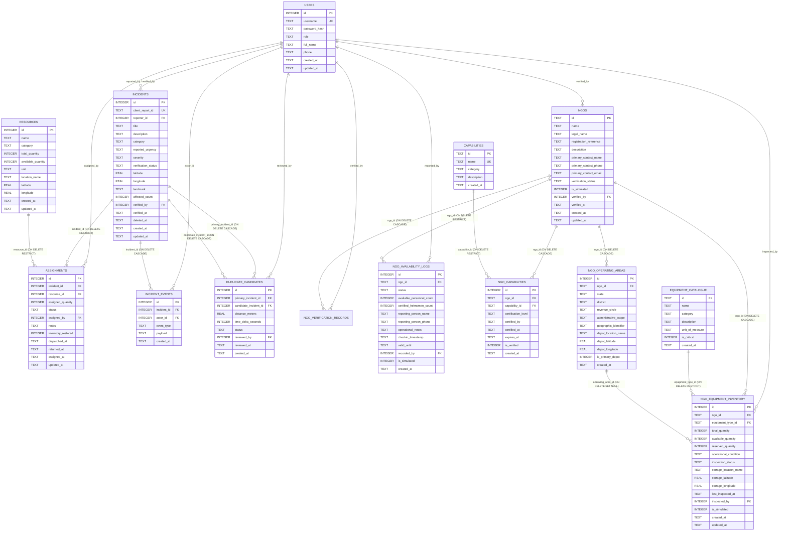

# Database Schema & Data Integrity — SURAKSHA GRID
### Relational SQLite Architecture (Engine: `better-sqlite3`)
**Document Version:** 2.1.0  
**Schema Version:** Migration 003 Applied  
**Last Updated:** 2026-11-01  

---

## 1. Relational Entity-Relationship Diagram



---

## 2. Connection Initialization Pragmas

Every database connection established via `better-sqlite3` MUST execute these initialization pragmas immediately:

```sql
PRAGMA journal_mode = WAL;          -- Write-Ahead Logging for high-concurrency non-blocking reads
PRAGMA foreign_keys = ON;           -- Enforce relational integrity and constraint checks
PRAGMA busy_timeout = 5000;         -- Wait up to 5000ms for locks instead of throwing SQLITE_BUSY
PRAGMA synchronous = NORMAL;        -- Optimal durability-performance balance in WAL mode
```

---

## 3. Implemented Core Tables (Migration 001)

These 6 tables represent the core response coordination database established in Phase 3.1:

### Table 1: `users`
```sql
CREATE TABLE users (
    id INTEGER PRIMARY KEY AUTOINCREMENT,
    username TEXT NOT NULL UNIQUE COLLATE NOCASE,
    password_hash TEXT NOT NULL,
    role TEXT NOT NULL CHECK (role IN ('citizen', 'volunteer', 'coordinator', 'admin')),
    full_name TEXT NOT NULL,
    phone TEXT,
    created_at TEXT NOT NULL DEFAULT (strftime('%Y-%m-%dT%H:%M:%fZ', 'now')),
    updated_at TEXT NOT NULL DEFAULT (strftime('%Y-%m-%dT%H:%M:%fZ', 'now'))
);
CREATE INDEX idx_users_role ON users(role);
CREATE INDEX idx_users_username ON users(username);
```

### Table 2: `incidents`
```sql
CREATE TABLE incidents (
    id INTEGER PRIMARY KEY AUTOINCREMENT,
    client_report_id TEXT NOT NULL UNIQUE,  -- UUIDv4 generated client-side for idempotency
    reporter_id INTEGER REFERENCES users(id) ON DELETE SET NULL,
    title TEXT NOT NULL,
    description TEXT NOT NULL,
    category TEXT NOT NULL CHECK (category IN (
        'MAROONED_RESCUE', 'MEDICAL_EMERGENCY', 'FOOD_WATER_CRISIS', 'INFRASTRUCTURE_BREACH', 'GENERAL_RELIEF'
    )),
    reported_urgency TEXT CHECK (reported_urgency IN ('LOW', 'MEDIUM', 'HIGH', 'CRITICAL')),
    severity TEXT NOT NULL DEFAULT 'MEDIUM' CHECK (severity IN ('LOW', 'MEDIUM', 'HIGH', 'CRITICAL')),
    verification_status TEXT NOT NULL DEFAULT 'PENDING' CHECK (verification_status IN ('PENDING', 'VERIFIED', 'REJECTED', 'RESOLVED')),
    latitude REAL,
    longitude REAL,
    landmark TEXT NOT NULL,
    affected_count INTEGER NOT NULL DEFAULT 1 CHECK (affected_count >= 0),
    verified_by INTEGER REFERENCES users(id) ON DELETE SET NULL,
    verified_at TEXT,
    deleted_at TEXT,
    created_at TEXT NOT NULL DEFAULT (strftime('%Y-%m-%dT%H:%M:%fZ', 'now')),
    updated_at TEXT NOT NULL DEFAULT (strftime('%Y-%m-%dT%H:%M:%fZ', 'now'))
);
CREATE INDEX idx_incidents_client_id ON incidents(client_report_id);
CREATE INDEX idx_incidents_verification ON incidents(verification_status);
CREATE INDEX idx_incidents_severity ON incidents(severity);
CREATE INDEX idx_incidents_category ON incidents(category);
CREATE INDEX idx_incidents_coords ON incidents(latitude, longitude);
CREATE INDEX idx_incidents_created ON incidents(created_at DESC);
CREATE INDEX idx_incidents_active ON incidents(deleted_at) WHERE deleted_at IS NULL;
```

### Table 3: `resources`
```sql
CREATE TABLE resources (
    id INTEGER PRIMARY KEY AUTOINCREMENT,
    name TEXT NOT NULL,
    category TEXT NOT NULL CHECK (category IN (
        'WATER_PURIFICATION', 'FOOD_RATIONS', 'RESCUE_BOAT', 'MEDICAL_KIT', 'SHELTER_EQUIPMENT'
    )),
    total_quantity INTEGER NOT NULL CHECK (total_quantity >= 0),
    available_quantity INTEGER NOT NULL CHECK (available_quantity >= 0 AND available_quantity <= total_quantity),
    unit TEXT NOT NULL,
    location_name TEXT NOT NULL,
    latitude REAL,
    longitude REAL,
    created_at TEXT NOT NULL DEFAULT (strftime('%Y-%m-%dT%H:%M:%fZ', 'now')),
    updated_at TEXT NOT NULL DEFAULT (strftime('%Y-%m-%dT%H:%M:%fZ', 'now'))
);
CREATE INDEX idx_resources_category ON resources(category);
CREATE INDEX idx_resources_available ON resources(available_quantity);
```

### Table 4: `assignments`
```sql
CREATE TABLE assignments (
    id INTEGER PRIMARY KEY AUTOINCREMENT,
    incident_id INTEGER NOT NULL REFERENCES incidents(id) ON DELETE RESTRICT,
    resource_id INTEGER NOT NULL REFERENCES resources(id) ON DELETE RESTRICT,
    assigned_quantity INTEGER NOT NULL CHECK (assigned_quantity > 0),
    status TEXT NOT NULL DEFAULT 'ASSIGNED' CHECK (status IN (
        'ASSIGNED', 'IN_TRANSIT', 'DELIVERED', 'RETURNED', 'CANCELLED'
    )),
    inventory_restored INTEGER NOT NULL DEFAULT 0 CHECK (inventory_restored IN (0, 1)),
    assigned_by INTEGER NOT NULL REFERENCES users(id) ON DELETE RESTRICT,
    notes TEXT,
    dispatched_at TEXT,
    returned_at TEXT,
    assigned_at TEXT NOT NULL DEFAULT (strftime('%Y-%m-%dT%H:%M:%fZ', 'now')),
    updated_at TEXT NOT NULL DEFAULT (strftime('%Y-%m-%dT%H:%M:%fZ', 'now'))
);
CREATE INDEX idx_assignments_incident ON assignments(incident_id);
CREATE INDEX idx_assignments_resource ON assignments(resource_id);
CREATE INDEX idx_assignments_status ON assignments(status);
```

### Table 5: `incident_events`
```sql
CREATE TABLE incident_events (
    id INTEGER PRIMARY KEY AUTOINCREMENT,
    incident_id INTEGER NOT NULL REFERENCES incidents(id) ON DELETE CASCADE,
    actor_id INTEGER REFERENCES users(id) ON DELETE SET NULL,
    event_type TEXT NOT NULL CHECK (event_type IN (
        'CREATED', 'VERIFIED', 'REJECTED', 'SEVERITY_UPDATED',
        'RESOURCE_ASSIGNED', 'RESOURCE_DISPATCHED', 'RESOURCE_DELIVERED',
        'RESOURCE_RETURNED', 'ASSIGNMENT_CANCELLED', 'DUPLICATE_FLAGGED',
        'DUPLICATE_RESOLVED', 'STATUS_RESOLVED', 'INCIDENT_ARCHIVED'
    )),
    payload TEXT,
    created_at TEXT NOT NULL DEFAULT (strftime('%Y-%m-%dT%H:%M:%fZ', 'now'))
);
CREATE INDEX idx_events_incident ON incident_events(incident_id, created_at ASC);
CREATE INDEX idx_events_type ON incident_events(event_type);
```

### Table 6: `duplicate_candidates`
```sql
CREATE TABLE duplicate_candidates (
    id INTEGER PRIMARY KEY AUTOINCREMENT,
    primary_incident_id INTEGER NOT NULL REFERENCES incidents(id) ON DELETE CASCADE,
    candidate_incident_id INTEGER NOT NULL REFERENCES incidents(id) ON DELETE CASCADE,
    distance_meters REAL NOT NULL,
    time_delta_seconds INTEGER NOT NULL,
    status TEXT NOT NULL DEFAULT 'SUGGESTED' CHECK (status IN ('SUGGESTED', 'DISMISSED', 'MERGED')),
    reviewed_by INTEGER REFERENCES users(id) ON DELETE SET NULL,
    reviewed_at TEXT,
    created_at TEXT NOT NULL DEFAULT (strftime('%Y-%m-%dT%H:%M:%fZ', 'now')),
    CONSTRAINT uq_duplicate_pair UNIQUE (primary_incident_id, candidate_incident_id),
    CHECK (primary_incident_id < candidate_incident_id) -- Canonical ordering
);
CREATE INDEX idx_dup_primary ON duplicate_candidates(primary_incident_id);
CREATE INDEX idx_dup_candidate ON duplicate_candidates(candidate_incident_id);
CREATE INDEX idx_dup_status ON duplicate_candidates(status);
```

---

## 4. Implemented NGO Network & Equipment Tracking (Migration 002)

Established in Phase 4.1. Provides normalized foundations for civil society mobilization, capability mapping, equipment inventory tracking, and time-sensitive availability verification.

### Table 7: `ngos` (Civil Society Registry)
```sql
CREATE TABLE ngos (
    id TEXT PRIMARY KEY,                       -- UUIDv4 or unique code
    name TEXT NOT NULL,
    legal_name TEXT,
    registration_reference TEXT,              -- Society Reg No, Trust Deed, or Darpan ID
    description TEXT,
    primary_contact_name TEXT NOT NULL,
    primary_contact_phone TEXT NOT NULL,
    primary_contact_email TEXT,
    verification_status TEXT NOT NULL DEFAULT 'DOCUMENTED_IN_DDMP' CHECK (
        verification_status IN (
            'DOCUMENTED_IN_DDMP',
            'IDENTITY_VERIFIED',
            'CURRENTLY_OPERATIONAL',
            'AVAILABILITY_CONFIRMED',
            'EQUIPMENT_INDEPENDENTLY_VERIFIED'
        )
    ),
    is_simulated INTEGER NOT NULL DEFAULT 1 CHECK (is_simulated IN (0, 1)),
    verified_by INTEGER REFERENCES users(id) ON DELETE SET NULL,
    verified_at TEXT,
    created_at TEXT NOT NULL DEFAULT (strftime('%Y-%m-%dT%H:%M:%fZ', 'now')),
    updated_at TEXT NOT NULL DEFAULT (strftime('%Y-%m-%dT%H:%M:%fZ', 'now')),
    deleted_at TEXT
);
CREATE INDEX idx_ngos_verification ON ngos(verification_status);
CREATE INDEX idx_ngos_simulated ON ngos(is_simulated);
CREATE INDEX idx_ngos_name ON ngos(name);
CREATE INDEX idx_ngos_active ON ngos(deleted_at) WHERE deleted_at IS NULL;
```

### Table 7b: `ngo_verification_records` (Normalized Multi-Dimensional Verification Ledger)
```sql
CREATE TABLE ngo_verification_records (
    id INTEGER PRIMARY KEY AUTOINCREMENT,
    ngo_id TEXT NOT NULL REFERENCES ngos(id) ON DELETE CASCADE,
    dimension TEXT NOT NULL CHECK (
        dimension IN (
            'DOCUMENTED_IN_DDMP',
            'IDENTITY_VERIFIED',
            'CURRENTLY_OPERATIONAL',
            'AVAILABILITY_CONFIRMED',
            'EQUIPMENT_INDEPENDENTLY_VERIFIED'
        )
    ),
    is_verified INTEGER NOT NULL DEFAULT 1 CHECK (is_verified IN (0, 1)),
    verified_by INTEGER REFERENCES users(id) ON DELETE SET NULL,
    verified_at TEXT NOT NULL DEFAULT (strftime('%Y-%m-%dT%H:%M:%fZ', 'now')),
    valid_until TEXT,
    evidence_reference TEXT,
    notes TEXT,
    is_current INTEGER NOT NULL DEFAULT 1 CHECK (is_current IN (0, 1)),
    created_at TEXT NOT NULL DEFAULT (strftime('%Y-%m-%dT%H:%M:%fZ', 'now'))
);
CREATE INDEX idx_ngo_verif_ngo ON ngo_verification_records(ngo_id);
CREATE INDEX idx_ngo_verif_dim ON ngo_verification_records(dimension, is_current);
CREATE UNIQUE INDEX uq_ngo_verif_current ON ngo_verification_records(ngo_id, dimension) WHERE is_current = 1;
```

### Table 8: `capabilities` (Standard Capabilities Catalogue)
```sql
CREATE TABLE capabilities (
    id TEXT PRIMARY KEY,                       -- Unique capability key
    name TEXT NOT NULL UNIQUE,
    category TEXT NOT NULL CHECK (
        category IN (
            'RESCUE_OPERATIONS',
            'MEDICAL_HEALTH',
            'WATER_SANITATION',
            'SHELTER_RELIEF',
            'LOGISTICS_SUPPLY',
            'COMMUNITY_PREPAREDNESS'
        )
    ),
    description TEXT,
    created_at TEXT NOT NULL DEFAULT (strftime('%Y-%m-%dT%H:%M:%fZ', 'now'))
);
CREATE INDEX idx_capabilities_category ON capabilities(category);
```

### Table 9: `ngo_capabilities` (Normalized NGO Capability Association)
```sql
CREATE TABLE ngo_capabilities (
    id INTEGER PRIMARY KEY AUTOINCREMENT,
    ngo_id TEXT NOT NULL REFERENCES ngos(id) ON DELETE CASCADE,
    capability_id TEXT NOT NULL REFERENCES capabilities(id) ON DELETE RESTRICT,
    certification_level TEXT NOT NULL DEFAULT 'BASIC' CHECK (
        certification_level IN ('BASIC', 'INTERMEDIATE', 'ADVANCED', 'SPECIALIST')
    ),
    certified_by TEXT,
    certified_at TEXT,
    expires_at TEXT,
    is_verified INTEGER NOT NULL DEFAULT 0 CHECK (is_verified IN (0, 1)),
    created_at TEXT NOT NULL DEFAULT (strftime('%Y-%m-%dT%H:%M:%fZ', 'now')),
    CONSTRAINT uq_ngo_capability UNIQUE (ngo_id, capability_id)
);
CREATE INDEX idx_ngo_cap_ngo ON ngo_capabilities(ngo_id);
CREATE INDEX idx_ngo_cap_capability ON ngo_capabilities(capability_id);
```

### Table 10: `equipment_catalogue` (Master Equipment Catalogue)
```sql
CREATE TABLE equipment_catalogue (
    id TEXT PRIMARY KEY,                       -- e.g. 'INFLATABLE_BOAT', 'LIFEJACKET'
    name TEXT NOT NULL,
    category TEXT NOT NULL CHECK (
        category IN (
            'RESCUE_WATERCRAFT',
            'LIFE_SAFETY',
            'MEDICAL_FIRST_AID',
            'WATER_SANITATION',
            'SHELTER_LOGISTICS',
            'COMMUNICATIONS',
            'POWER_DEWATERING',
            'OTHER'
        )
    ),
    description TEXT,
    unit_of_measure TEXT NOT NULL DEFAULT 'UNITS',
    is_critical INTEGER NOT NULL DEFAULT 0 CHECK (is_critical IN (0, 1)),
    created_at TEXT NOT NULL DEFAULT (strftime('%Y-%m-%dT%H:%M:%fZ', 'now'))
);
CREATE INDEX idx_eq_catalogue_category ON equipment_catalogue(category);
```

### Table 11: `ngo_equipment_inventory` (Equipment Fleet & Condition Tracking)
```sql
CREATE TABLE ngo_equipment_inventory (
    id INTEGER PRIMARY KEY AUTOINCREMENT,
    ngo_id TEXT NOT NULL REFERENCES ngos(id) ON DELETE CASCADE,
    equipment_type_id TEXT NOT NULL REFERENCES equipment_catalogue(id) ON DELETE RESTRICT,
    operating_area_id INTEGER REFERENCES ngo_operating_areas(id) ON DELETE SET NULL,
    total_quantity INTEGER NOT NULL CHECK (total_quantity >= 0),
    available_quantity INTEGER NOT NULL CHECK (available_quantity >= 0),
    reserved_quantity INTEGER NOT NULL DEFAULT 0 CHECK (reserved_quantity >= 0),
    operational_condition TEXT NOT NULL DEFAULT 'SERVICEABLE' CHECK (
        operational_condition IN (
            'SERVICEABLE',
            'NEEDS_MAINTENANCE',
            'UNDER_REPAIR',
            'UNSERVICEABLE'
        )
    ),
    inspection_status TEXT NOT NULL DEFAULT 'SELF_REPORTED' CHECK (
        inspection_status IN (
            'SELF_REPORTED',
            'PHYSICALLY_INSPECTED',
            'AUDIT_EXPIRED'
        )
    ),
    storage_location_name TEXT,
    storage_latitude REAL,
    storage_longitude REAL,
    last_inspected_at TEXT,
    inspected_by INTEGER REFERENCES users(id) ON DELETE SET NULL,
    is_simulated INTEGER NOT NULL DEFAULT 1 CHECK (is_simulated IN (0, 1)),
    created_at TEXT NOT NULL DEFAULT (strftime('%Y-%m-%dT%H:%M:%fZ', 'now')),
    updated_at TEXT NOT NULL DEFAULT (strftime('%Y-%m-%dT%H:%M:%fZ', 'now')),
    CONSTRAINT chk_equipment_quantity_balance CHECK (available_quantity + reserved_quantity <= total_quantity),
    CONSTRAINT chk_serviceable_availability CHECK (operational_condition = 'SERVICEABLE' OR available_quantity = 0)
);
CREATE INDEX idx_ngo_eq_ngo ON ngo_equipment_inventory(ngo_id);
CREATE INDEX idx_ngo_eq_type ON ngo_equipment_inventory(equipment_type_id);
CREATE INDEX idx_ngo_eq_area ON ngo_equipment_inventory(operating_area_id);
CREATE INDEX idx_ngo_eq_avail ON ngo_equipment_inventory(available_quantity);
CREATE INDEX idx_ngo_eq_cond ON ngo_equipment_inventory(operational_condition);
CREATE UNIQUE INDEX uq_ngo_equipment_depot ON ngo_equipment_inventory(ngo_id, equipment_type_id, operating_area_id, operational_condition) WHERE operating_area_id IS NOT NULL;
CREATE UNIQUE INDEX uq_ngo_equipment_unassigned ON ngo_equipment_inventory(ngo_id, equipment_type_id, operational_condition) WHERE operating_area_id IS NULL;
```

### Table 12: `ngo_availability_logs` (Time-Sensitive Roster Verification)
```sql
CREATE TABLE ngo_availability_logs (
    id INTEGER PRIMARY KEY AUTOINCREMENT,
    ngo_id TEXT NOT NULL REFERENCES ngos(id) ON DELETE RESTRICT,
    status TEXT NOT NULL CHECK (
        status IN (
            'ACTIVE_STANDBY',
            'DEPLOYED',
            'PARTIALLY_AVAILABLE',
            'UNAVAILABLE',
            'INACTIVE_STALE'
        )
    ),
    available_personnel_count INTEGER NOT NULL DEFAULT 0 CHECK (available_personnel_count >= 0),
    certified_helmsmen_count INTEGER NOT NULL DEFAULT 0 CHECK (certified_helmsmen_count >= 0),
    reporting_person_name TEXT NOT NULL,
    reporting_person_phone TEXT NOT NULL,
    operational_notes TEXT,
    checkin_timestamp TEXT NOT NULL DEFAULT (strftime('%Y-%m-%dT%H:%M:%fZ', 'now')),
    valid_until TEXT,
    recorded_by INTEGER REFERENCES users(id) ON DELETE SET NULL,
    is_simulated INTEGER NOT NULL DEFAULT 1 CHECK (is_simulated IN (0, 1)),
    created_at TEXT NOT NULL DEFAULT (strftime('%Y-%m-%dT%H:%M:%fZ', 'now'))
);
CREATE INDEX idx_ngo_avail_ngo_ts ON ngo_availability_logs(ngo_id, checkin_timestamp DESC);
CREATE INDEX idx_ngo_avail_status ON ngo_availability_logs(status);
```

### Table 13: `ngo_operating_areas` (Administrative Scope & Physical Depots)
```sql
CREATE TABLE ngo_operating_areas (
    id INTEGER PRIMARY KEY AUTOINCREMENT,
    ngo_id TEXT NOT NULL REFERENCES ngos(id) ON DELETE CASCADE,
    state TEXT NOT NULL DEFAULT 'Assam',
    district TEXT NOT NULL,
    revenue_circle TEXT,
    administrative_scope TEXT NOT NULL CHECK (
        administrative_scope IN (
            'STATE',
            'DISTRICT',
            'REVENUE_CIRCLE',
            'BLOCK',
            'GRAM_PANCHAYAT'
        )
    ),
    geographic_identifier TEXT,               -- Official LGD code (nullable; never invented)
    depot_location_name TEXT NOT NULL,        -- Distinct descriptive label
    depot_latitude REAL,
    depot_longitude REAL,
    is_primary_depot INTEGER NOT NULL DEFAULT 1 CHECK (is_primary_depot IN (0, 1)),
    created_at TEXT NOT NULL DEFAULT (strftime('%Y-%m-%dT%H:%M:%fZ', 'now')),
    CONSTRAINT uq_ngo_area UNIQUE (ngo_id, district, revenue_circle, administrative_scope)
);
CREATE INDEX idx_ngo_areas_ngo ON ngo_operating_areas(ngo_id);
CREATE INDEX idx_ngo_areas_district ON ngo_operating_areas(district, revenue_circle);
CREATE INDEX idx_ngo_areas_coords ON ngo_operating_areas(depot_latitude, depot_longitude);
```

---

## 5. Verification Semantics & Data Governance Rules

### 5.1 The 5 Explicit Verification States
SURAKSHA GRID prohibits collapsing organizational readiness into a single boolean `is_verified` flag. The 5 discrete states are:
1. `DOCUMENTED_IN_DDMP`: Organization appears in historical District Disaster Management Plan directories. Establishes legal existence reference only; does not establish current field capacity or personnel readiness.
2. `IDENTITY_VERIFIED`: Organization registration (NGO Darpan ID, Societies Registration Act, 12A/80G) independently audited and validated against government portals.
3. `CURRENTLY_OPERATIONAL`: Physical ground presence, active local office, and current-year field activities confirmed in the district.
4. `AVAILABILITY_CONFIRMED`: Responder roster actively confirmed via time-sensitive field check-in within the past 24–48 hours.
5. `EQUIPMENT_INDEPENDENTLY_VERIFIED`: Physical emergency assets (inflatable boats, lifejackets, water purification plants) physically inspected and certified serviceable by DDMA/SDRF inspectors within the past 90 days.

### 5.2 Simulated vs Verified Data Governance
- **`is_simulated` Invariant:** Every record inserted for demonstration or testing purposes must explicitly carry `is_simulated = 1`.
- **Zero Hallucinated Partnerships:** Fictional NGO names and synthetic equipment inventories must never be stored with `is_simulated = 0` or presented as authentic state-contracted emergency response teams.

---

## 6. Migration Execution & Rollback Architecture

### 6.1 Idempotent Execution Pipeline
- Migrations are version-tracked in `schema_migrations (version, name, applied_at)`.
- `initializeSchema(db, targetVersion?)` executes within an atomic SQLite transaction (`db.transaction`).
- Re-running `initializeSchema(db)` when already at the latest version applies 0 migrations and preserves existing data completely.

### 6.2 Rollback Architecture (`rollbackSchema`)
- `rollbackSchema(db, targetVersion = 0)` executes down migrations in reverse version order within a transaction.
- Rolling back Migration 002 cleanly drops the 7 NGO tables, removes Migration 2 from `schema_migrations`, and preserves Migration 001 core tables and data intact.
