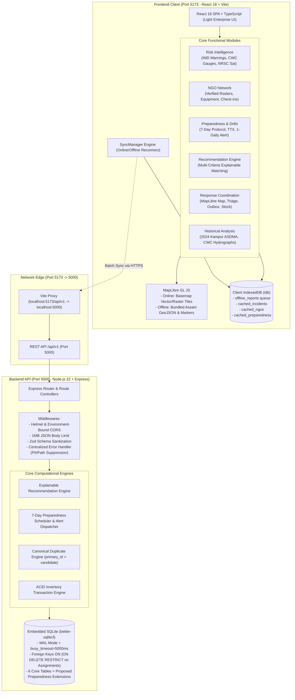
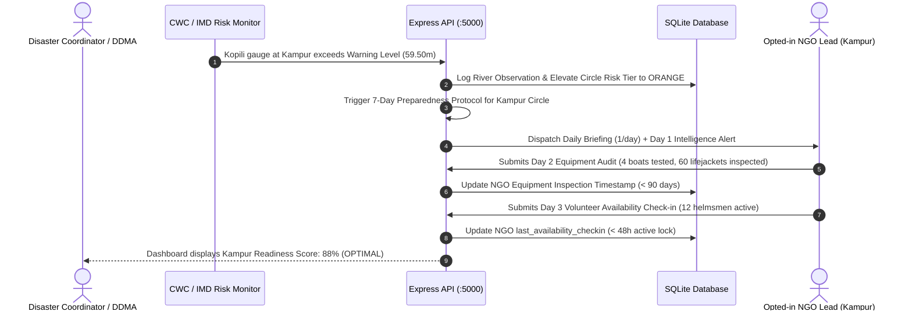
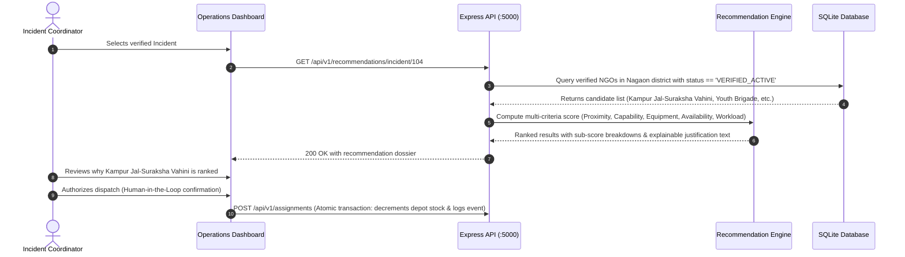

# System Architecture & Data Flows — SURAKSHA GRID
### NGO-Focused Disaster Preparedness, Risk Intelligence and Response Coordination Architecture

---

## 1. High-Level Architectural Overview

SURAKSHA GRID employs a decoupled, offline-first client-server architecture built around the core principle:
**"Turn disaster intelligence into NGO preparedness and coordinated response."**



---

## 2. Client-Side Architecture

The frontend is a single-page application built on React 18, Vite, and TypeScript.

### 2.1 Storage Layer: IndexedDB via `idb`
1. **`offline_reports` Store:** Holds client-originated distress submissions stamped with client-generated UUIDv4 (`client_report_id`). Survives tab closure, power loss, and reboots.
2. **`cached_incidents` Store:** Read-only snapshot of verified incidents for offline map rendering.
3. **`cached_ngos` & `cached_preparedness` Stores:** Cached local copies of NGO rosters and 7-day checklists for field operations when cellular towers are down.

### 2.2 Network State & Reconnect Synchronization
The `SyncManager` service monitors connectivity:
- **Online Detection:** Detects `online` event and verifies network path with `HEAD /api/v1/health`.
- **Itemized Replay:** Ingests queued reports via `POST /api/v1/sync/batch`. Clears `synced` and `already_synced` items. Preserves `IDEMPOTENCY_CONFLICT` items in outbox for coordinator resolution without data loss.

### 2.3 Dual-Mode Cartography
- **Online Mode:** MapLibre GL JS streams public raster/vector tiles with interactive incident clusters and river gauge overlays.
- **Offline Fallback Mode:** When disconnected, MapLibre renders bundled local GeoJSON boundaries (Nagaon and Kampur circles) and cached markers over a clean neutral grid.

---

## 3. Server-Side Architecture & Network Standardization

- **Standardized Network Ports:** Backend REST API strictly listens on `http://localhost:5000/api/v1`. Frontend dev server strictly listens on `http://localhost:5173`. Port 8000 is prohibited.
- **Middleware Pipeline:**
  1. `helmet()` sets HTTP security headers.
  2. `cors()` enforces explicit origins (`CORS_ORIGIN=http://localhost:5173`).
  3. `express.json({ limit: '1mb' })` protects memory against denial-of-service surges.
  4. Zod request validation filters and strips unauthorized attributes.
  5. Centralized `errorHandler` suppresses internal paths, database queries, and stack traces.
- **Database Engine (`better-sqlite3`):**
  - `PRAGMA foreign_keys = ON;` enforces relational integrity.
  - `PRAGMA busy_timeout = 5000;` prevents `SQLITE_BUSY` errors under high concurrent write loads.
  - `PRAGMA journal_mode = WAL;` enables non-blocking concurrent reads during writes.

---

## 4. End-to-End Operational Flows

### 4.1 Flow 1: Risk Intelligence Trigger to 7-Day NGO Preparedness Drill



---

### 4.2 Flow 2: Explainable NGO Recommendation for Ground Distress



---

### 4.3 Flow 3: Preserved Offline Incident Submission & Idempotent Sync

```mermaid
sequenceDiagram
    autonumber
    actor Vol as Field Volunteer (Offline)
    participant Form as Report Form UI
    participant IDB as Client IndexedDB
    participant Sync as SyncManager
    participant API as Express API (:5000)
    participant DB as SQLite Database

    Vol->>Form: Submits distress report (14 marooned, landmark: Kamalabari Ghat)
    Form->>Form: Generate UUIDv4 (client_report_id)
    Form->>IDB: Write to 'offline_reports' (status: QUEUED)
    Form-->>Vol: Shows "Saved to Offline Outbox (UUID: ...)"

    Note over Vol,Sync: Boat moves into cell tower range (Uplink restored)
    Sync->>Sync: Detects 'online' event + verifies HEAD /api/v1/health
    Sync->>API: POST /api/v1/sync/batch [Array of queued reports]
    
    API->>DB: Check client_report_id existence
    alt New report
        API->>DB: INSERT INTO incidents (...) RETURNING id
        API-->>Sync: Item result: 'synced' (New Incident ID created)
    else Identical retried payload
        API-->>Sync: Item result: 'already_synced' (Zero mutation)
    else Conflicting payload with same UUID
        API-->>Sync: Item result: 'rejected' (code: 'IDEMPOTENCY_CONFLICT', server draft preserved)
    end

    Sync->>IDB: Delete 'synced' and 'already_synced' items; flag 'CONFLICT' for user resolution
```
