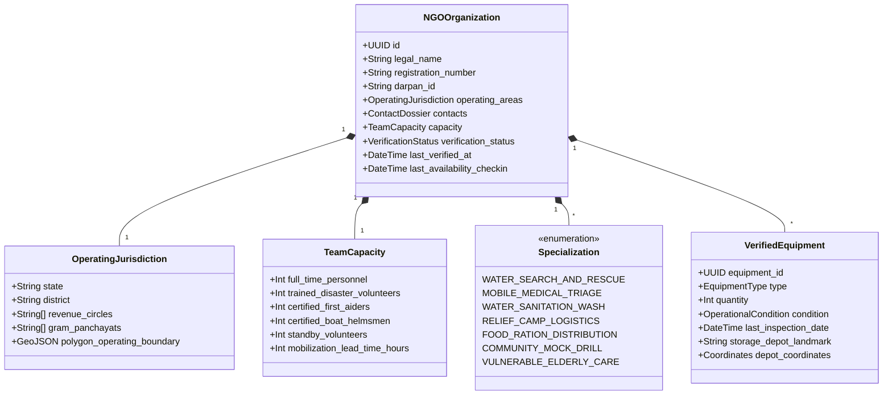
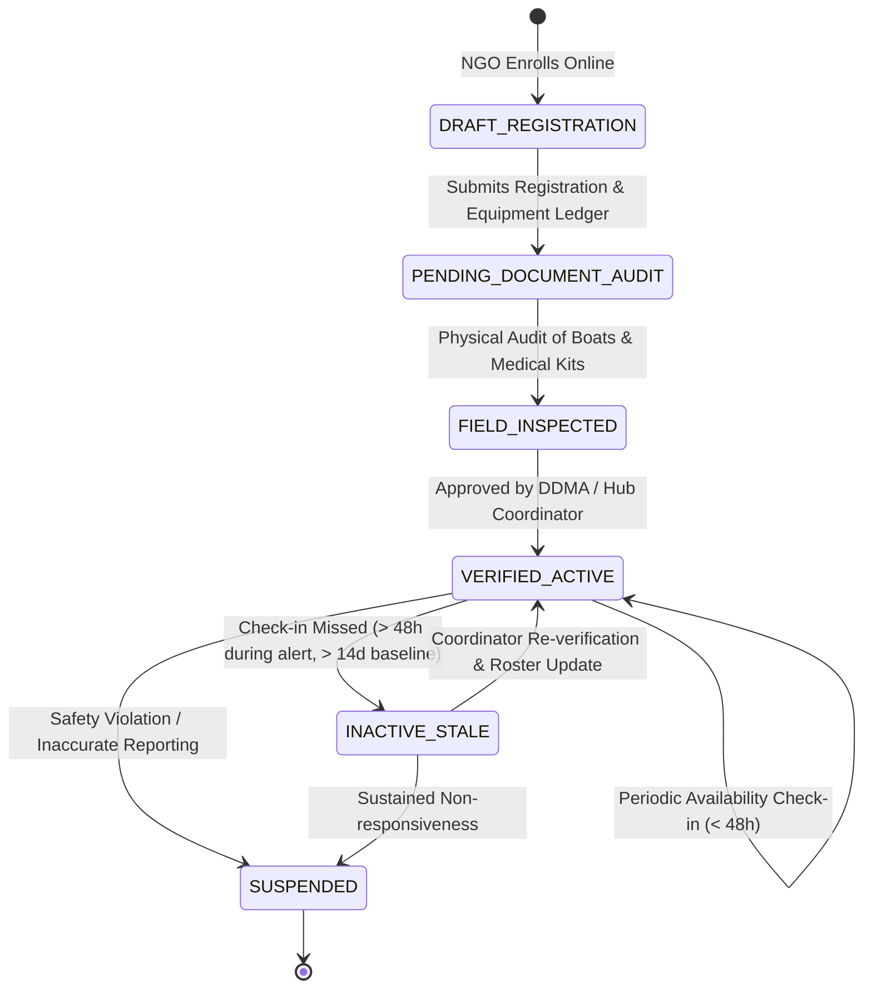

# NGO Network Capability & Verification Model — SURAKSHA GRID
### Framework for Ground-Level Preparedness, Resource Verification & Roster Auditing

---

## 1. The Core Philosophy of Verified NGO Preparedness

Traditional disaster platforms rely on static directory listings of civil society organizations. In a real flood emergency, static directories produce catastrophic dispatch failures:
- Organizations listed in directories may have relocated, dissolved, or exhausted volunteer capacity.
- Self-reported claims of "rescue boats" often refer to uninspected, broken craft without outboard motors or trained helmsmen.
- Stale contact numbers cause dispatch coordinators to waste critical hours calling inactive phone numbers.

SURAKSHA GRID enforces an **Active Roster Verification & Periodic Recertification Model**:

> [!IMPORTANT]
> **Zero-Staleness Invariant:**
> An NGO profile is never assumed to be operational based solely on a historic directory listing. 
> To be marked `VERIFIED_ACTIVE`, an organization must maintain verified DDMA/network accreditation, complete periodic capability audits, and confirm live roster availability within the last 48 hours during heightened risk windows.

---

## 2. NGO Entity & Capability Schema

Every participating civil society organization is modeled with granular operational dimensions:

---

## 3. NGO Capability Profiles (Assam / Nagaon Pilot Entities)

To demonstrate realistic ground coordination in the **Nagaon / Kampur Revenue Circle** pilot, SURAKSHA GRID categorizes participating local organizations into defined operational archetypes:

| Organization Profile | Primary Specialization | Verified Equipment | Verified Personnel | Initial Status |
|---|---|---|:---:|:---:|
| **Kampur Jal-Suraksha Vahini** | Water Search & Rescue, High-Water Evacuation | 4 Inflatable Motorboats (OBL), 60 Adult Lifejackets, 2 Throw Ropes | 12 Certified Helmsmen, 18 Rescuers | `VERIFIED_ACTIVE` (Check-in: 4h ago) |
| **Nagaon Seva Samiti** | Relief Camp Operations, Cooked Meal Supply | Mobile Kitchen Unit, 400 Ration Tarpaulins, Water Storage Bladders | 8 Coordinators, 35 Relief Volunteers | `VERIFIED_ACTIVE` (Check-in: 12h ago) |
| **Brahmaputra Health Relief Trust** | Mobile Medical Triage, Anti-Venom & Waterborne Disease | 2 Water Ambulances, 15 Mobile Trauma Kits, 4 Oxygen Concentrators | 4 Paramedics, 2 Doctors, 8 Nurses | `VERIFIED_ACTIVE` (Check-in: 6h ago) |
| **Kampur Community Youth Brigade** | Tabletop Drills, Early Warning Dissemination, Sandbagging | Megaphones, High-Visibility Vests, Hand Radios | 40 Community Field Volunteers | `VERIFIED_ACTIVE` (Check-in: 1h ago) |
| **Central Assam Relief Action** | Water Purification (WASH) | 3 RO Water Purification Trail Units (5,000 L/day) | 6 Water Techs, 14 Field Workers | `PENDING_REVERIFICATION` (Check-in: >48h ago) |

---

## 4. Verification Lifecycle & State Machine

### Transition Invariants:
1. **Equipment Condition Checks:** Equipment must record a physical inspection date within the previous 90 days. Equipment in `REPAIR_REQUIRED` condition is strictly excluded from recommendation engine calculations.
2. **Roster Freshness Window:**
   - **Baseline Conditions:** Check-in required every 14 days.
   - **Alert Conditions (IMD Orange/Red or CWC Warning Level):** Check-in required every **24 to 48 hours**. Failure to check in downgrades status to `INACTIVE_STALE`.
3. **No Automated Recommendation for Unverified Entities:** The recommendation engine filters out any organization whose status is not `VERIFIED_ACTIVE`.

