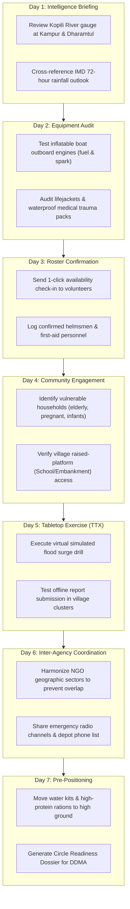

# Seven-Day Preparedness & Mock Drill Management — SURAKSHA GRID
### Structured Pre-Disaster Mobilization, Tabletop Exercises & Non-Intrusive Alerting

---

## 1. Concept of Operations: The 7-Day Preparedness Cycle

Disaster casualties in riverine flash floods peak when early warnings fail to translate into organized pre-impact community action. Even when IMD issues a 5-day forecast or CWC notes rising upstream river gauges, response teams often wait until floodwaters physically breach village embankments before mobilizing.

SURAKSHA GRID operationalizes a **Seven-Day Structured Preparedness Programme** designed to transform risk intelligence into progressive community readiness:

```
┌────────────────────────────────────────────────────────────────────────┐
│               7-DAY DISASTER PREPAREDNESS PROTOCOL                     │
├───────┬──────────────────────┬────────────────────────────────────────┤
│ DAY   │ OPERATIONAL PHASE    │ PRIMARY ACTIONS & VERIFICATION         │
├───────┼──────────────────────┼────────────────────────────────────────┤
│ Day 1 │ Risk Intelligence &  │ Review CWC gauge trends & IMD forecast.│
│       │ Early Advisory       │ Notify opted-in NGO leadership.        │
├───────┼──────────────────────┼────────────────────────────────────────┤
│ Day 2 │ Inventory & Asset    │ Physical inspection of rescue boats,   │
│       │ Inspection           │ OBL motors, batteries, lifejackets.    │
├───────┼──────────────────────┼────────────────────────────────────────┤
│ Day 3 │ Volunteer Roster &   │ Contact volunteers; confirm active,   │
│       │ Availability Lock    │ standby, and medical triage personnel. │
├───────┼──────────────────────┼────────────────────────────────────────┤
│ Day 4 │ Community Warning &  │ Village announcements via megaphones;  │
│       │ Evacuation Mapping   │ designate high-ground shelter routes.  │
├───────┼──────────────────────┼────────────────────────────────────────┤
│ Day 5 │ Tabletop Exercise    │ Simulated scenario: 60cm water rise in │
│       │ (TTX) & Simulation   │ Kampur; test mock allocation workflows.│
├───────┼──────────────────────┼────────────────────────────────────────┤
│ Day 6 │ Inter-NGO Sector     │ Coordinate joint staging depots;      │
│       │ Harmonization Drill  │ eliminate geographic coverage gaps.    │
├───────┼──────────────────────┼────────────────────────────────────────┤
│ Day 7 │ Operational Standby  │ Final readiness report; pre-position   │
│       │ & Staging Deployment │ water purification & medical assets.   │
└───────┴──────────────────────┴────────────────────────────────────────┘
```

---

## 2. Granular Daily Task Breakdown (Kampur Revenue Circle Pilot)



---

## 3. Strict Notification & Alerting Discipline

Alert fatigue is a lethal vulnerability in disaster response. When platforms flood volunteer phones with continuous automated notifications, coordinators mute notifications, resulting in missed life-safety warnings.

SURAKSHA GRID enforces **Strict Non-Intrusive Notification Rules**:

### 3.1 The Daily Briefing Constraint
- Participating NGOs receive **exactly ONE scheduled daily preparedness notification** (delivered at 07:00 IST).
- Contents: Current river stage relative to Danger Level, 24-hour weather outlook, and Day $N$ assigned preparedness checklist tasks.

### 3.2 Threshold-Driven Exception Alerts
Out-of-cycle urgent alerts are dispatched **ONLY** when a verified hydrometeorological trigger occurs:
1. **River Level Escalation:** CWC gauge level crosses **Warning Level** (59.50m at Kampur) or enters **Severe Flood** territory.
2. **Meteorological Upgrade:** IMD issues an upgraded warning (e.g. Yellow $\rightarrow$ Orange/Red Alert) for Nagaon/catchment.
3. **Critical Task Assignment:** DDMA or Hub Coordinator assigns an emergency pre-evacuation task.

### 3.3 Protocol for Alert Updates, Downgrades & Cancellations
When risk subsides (e.g. river recedes below Warning Level or IMD cancels rainfall warning):
- The platform issues an explicit **Alert Downgrade / Cancellation Notice**.
- Pending high-urgency tasks are automatically stepped down to routine monitoring.
- Audit history logs the reason and timestamp for the cancellation.

### 3.4 Opt-in and Authorization Invariant
- Notifications are transmitted strictly to verified, registered NGO representatives who have explicitly opted in.
- Unauthenticated or non-consenting parties are never spammed.

---

## 4. Preparedness Metrics & Readiness Index

The platform computes an objective, explainable **Preparedness Readiness Score** ($0 - 100\%$) for each participating organization and geographic circle:

$$\text{Readiness Score} = 0.35 \times (\text{Task Completion Rate}) + 0.30 \times (\text{Equipment Inspection Rate}) + 0.20 \times (\text{Roster Confirmation Rate}) + 0.15 \times (\text{TTX Participation})$$

- **Readiness Tiers:**
  - `OPTIMAL` ($\ge 85\%$): Fully certified for immediate deep-water search & rescue deployment.
  - `MODERATE` ($60 - 84\%$): Certified for logistics, relief camp management, and distribution.
  - `SUB-OPTIMAL` ($< 60\%$): Recommended only for localized community awareness; ineligible for boat dispatches.

